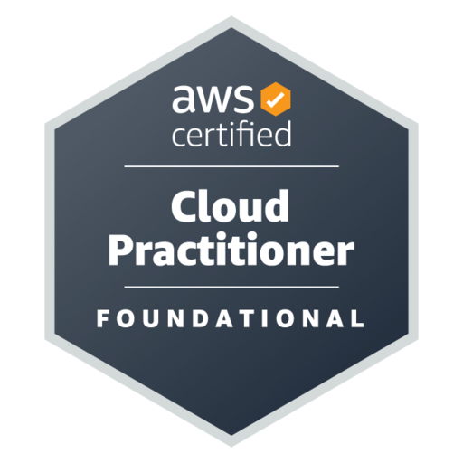
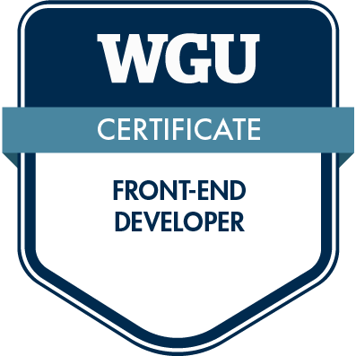
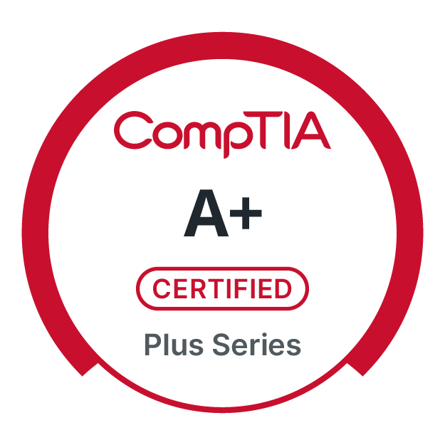
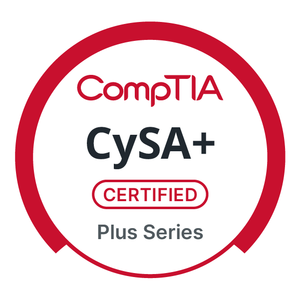

<!-- 2022-2024 OzzyTheDev, Please Don't Copy -->

# Hello All, I'm Jason!

Full Stack React Software Dev that likes Java and C# with a bachelor's degree in Software Engineering and Cybersecurity

## My Education

- B.S. Degree in Software Engineering (May 2025)
- B.S. in Cybersecurity & Information Assurance (August 2026)

## Stuff I want to learn more
- Terraform and Kubernetes (2027)
- Game Development in Godot (2026)
- 3D Modeling Blender (2026)

## Goals
- Join the United States Air Force!

## My Certificates

  

  

